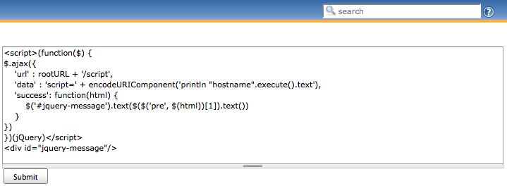

= jQuery Plugin

image:https://ci.jenkins.io/job/Plugins/job/jquery-plugin/job/master/badge/icon[Build Status,link="https://ci.jenkins.io/job/Plugins/job/jquery-plugin/job/master/"]
image:https://img.shields.io/github/v/release/jenkinsci/jquery-plugin?label=release[GitHub release,link="https://github.com/jenkinsci/jquery-plugin/releases/latest"]
image:https://img.shields.io/jenkins/plugin/i/jquery.svg?color=blue[Jenkins Plugin Installs,link="https://plugins.jenkins.io/jquery"]

This plugin is a library plugin that provides a shared version of jQuery (`1.12.4`) and the jQuery ColorBox extension (`hudson.plugins.jquery.colorbox`) for other Jenkins plugins.

[NOTE]
====
For newly developed plugins that require jQuery 3.x without global `PageDecorator` injection on every page, consider using the https://plugins.jenkins.io/jquery3-api/[jQuery3 API Plugin]. This plugin continues to be maintained for existing dependent plugins that rely on the `Q` (`jQuery.noConflict()`) binding or `org.kohsuke.stapler.jquery` adjunct.
====

== Usage

Because historical Jenkins views used `prototype.js` in core, this plugin binds `jQuery.noConflict()` to the global `Q` variable so `$` is not clobbered globally. You can use `Q` directly, or pass `Q` into an immediately invoked function expression (IIFE) to alias `$` locally:

[source,javascript]
----
(function($) {
    $(function() {
        // Use $ safely as jQuery inside this scope
    });
})(Q);
----

This plugin registers a global `PageDecorator` (`hudson.plugins.jquery.JQuery`) that injects `org.kohsuke.stapler.jquery` and `hudson.plugins.jquery.JQuery.jquery-no-conflict` into the header of pages rendered by Jenkins.

=== Optional ColorBox Adjunct

Plugins that wish to include the bundled jQuery ColorBox script and stylesheet can add the following Stapler adjunct to their Jelly views:

[source,xml]
----
<st:adjunct includes="hudson.plugins.jquery.colorbox"/>
----

== Changelog

* For recent releases, see https://github.com/jenkinsci/jquery-plugin/releases[GitHub Releases].
* For versions `1.12.4-0` and older, see link:CHANGELOG.adoc[CHANGELOG.adoc].
